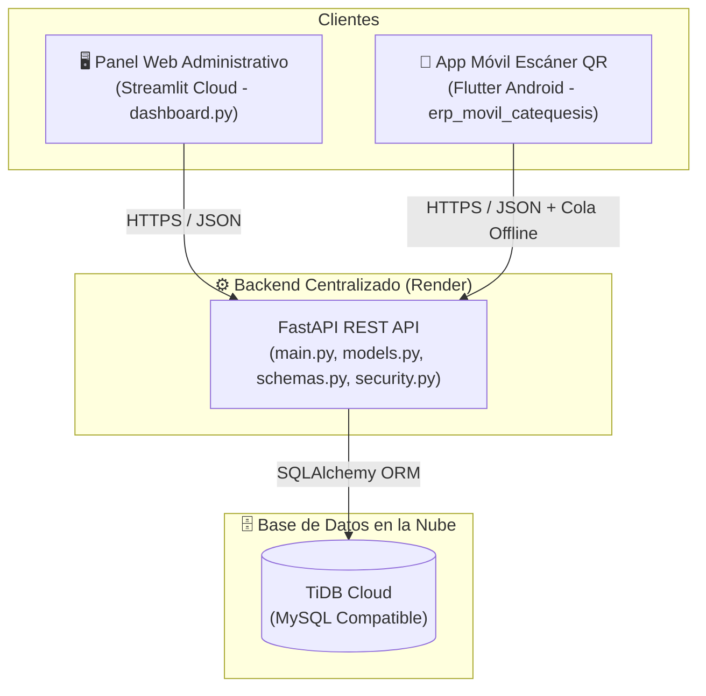
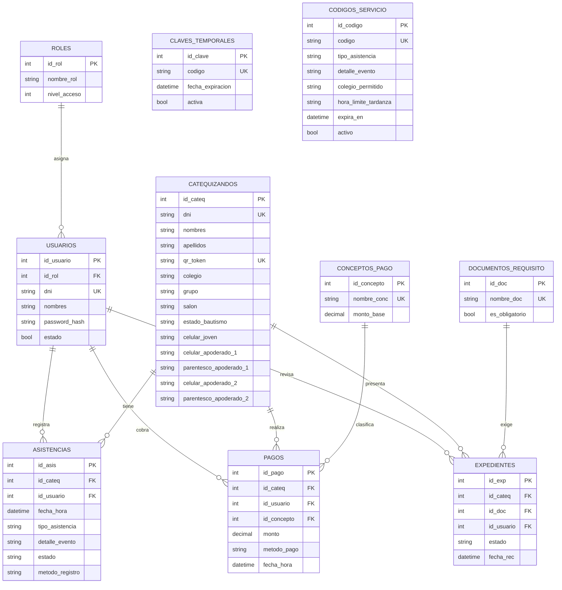
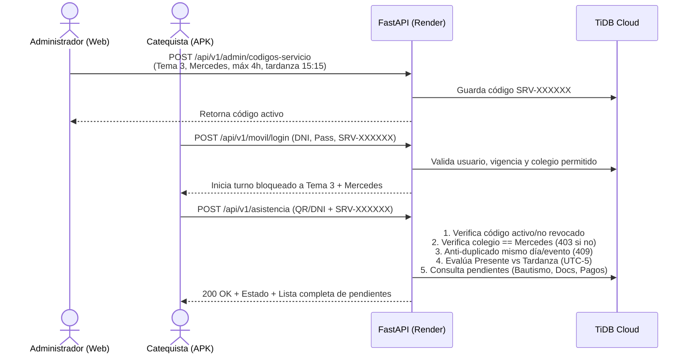

# ⛪ ERP Parroquial - Confirmación

Sistema integral de gestión logística, académica, financiera, documental y de control de asistencia mediante códigos QR para programas de catequesis de Confirmación.

---

## 1. Arquitectura del Sistema

El sistema opera bajo una arquitectura cliente-servidor desacoplada en la nube, conectando una API REST centralizada con un panel web administrativo y una aplicación móvil Android para trabajo en campo.



### Stack Tecnológico

| Capa | Tecnologías | Despliegue | Responsabilidad |
| :--- | :--- | :--- | :--- |
| **Backend (API)** | Python 3.11+, FastAPI, SQLAlchemy, Pydantic, `python-jose` (JWT), `passlib` (bcrypt) | Render (`erp-parroquia-api.onrender.com`) | Reglas de negocio, autenticación, RBAC, validaciones en tiempo real y migración automática de esquema. |
| **Base de Datos** | TiDB Cloud (compatible con MySQL) | TiDB Cloud | Almacenamiento relacional persistente con integridad referencial. |
| **Panel Web** | Python, Streamlit, Pandas, FPDF, OpenPyXL, QRCode | Streamlit Cloud | Administración integral, reportes Excel/PDF, carnets QR A4, tesorería, secretaría y backups. |
| **App Móvil** | Flutter (Dart) | Android (APK Release) | Escáner QR continuo, búsqueda manual, soporte offline y alertas en vivo. |

---

## 2. Modelo de Datos (Diagrama Entidad-Relación)

Al iniciar el servidor (`main.py`), SQLAlchemy sincroniza las tablas (`create_all`) y ejecuta sentencias `ALTER TABLE` controladas para mantener compatibilidad retroactiva sin pérdida de datos.



---

## 3. Reglas de Negocio y Catálogos

* **Colegios:** `Mercedes`, `Politécnico`, `Santa Mónica`, `César Vallejo`, `San Francisco de Borja` y `Particulares` (colegios privados y externos a la zona).
* **Bautismo:** `Bautizado` | `Por bautizar`.
* **Grupos y Salones:**
  * *Grupos:* `Sin asignar`, `Grupo Único`, `Grupo A`, `Grupo B`, `Grupo C`, `Grupo D`.
  * *Salones:* `Sin asignar`, `Salón 1`, `Salón 2`, `Salón 3`, `Salón 4`.
* **Calendario Anual de Asistencias:**
  * *Catequesis:* 26 sesiones (`Tema 1` a `Tema 26`).
  * *Misas:* 30 sesiones (`Misa 1` a `Misa 30`).
  * *Actividades Parroquiales (9):* `Bienvenida`, `Corpus Christi`, `Pollada`, `Marcha por la Paz`, `San Francisco de Asis`, `Retiro Espiritual`, `Confesión`, `Ensayo de Ceremonia`, `Ceremonia`.
* **Zona Horaria:** Las validaciones de tardanza y vencimientos de códigos de servicio operan en **Hora Perú (UTC-5)**.
* **Formato de Token QR:** `CAT-{DNI}` (actualizado automáticamente si se corrige el DNI del catequizando).

---

## 4. Flujo de Seguridad y Control de Asistencia QR



---

## 5. Seguridad y Control de Acceso (RBAC)

### Matriz de Permisos Web

| Rol | Resumen | Visualizador | Directorio | Asistencias | Tesorería | Secretaría | Grupos/Salones | Accesos Temp. | Usuarios | Backups |
| :--- | :---: | :---: | :---: | :---: | :---: | :---: | :---: | :---: | :---: | :---: |
| **Administrador / Coordinador** | ✅ | ✅ | ✅ | ✅ | ✅ | ✅ | ✅ | ✅ | ✅ | ✅ |
| **Vocal** | ✅ | 🔑* | ✅ | ✅ | 🔑* | 🔑* | ❌ | ❌ | ❌ | ❌ |
| **Secretario / Secretaria** | ✅ | 🔑* | ✅ | 🔑* | 🔑* | ✅ | ❌ | ❌ | ❌ | ❌ |
| **Tesorero / Tesorera** | ✅ | 🔑* | 🔑* | 🔑* | ✅ | 🔑* | ❌ | ❌ | ❌ | ❌ |
| **Catequista** | 🔑* | 🔑* | ✅ | ✅ | 🔑* | 🔑* | ❌ | ❌ | ❌ | ❌ |

> *`🔑*`: Desbloqueable temporalmente en la sesión mediante una **Clave Temporal Web (`TMP-XXXXXX`)** generada por un Administrador (`24h`, `48h`, `7d` o `Indeterminado`, revocable en vivo).*

---

## 6. Módulos del Panel Web (`dashboard.py`)

1. **📊 Resumen General:** KPIs principales, gráficos de recaudación y expedientes, y **Panel de Alertas** en 3 pestañas (*Pagos Pendientes*, *Documentos Faltantes/Observados* y *Baja Asistencia* configurable) con filtro, columna de colegio y exportación a Excel/PDF.
2. **🔎 Visualizador General:** Buscador unificado con botón **Buscar Ficha** que muestra en una sola vista todos los datos personales, grupo/salón, contactos, KPIs individuales y 5 pestañas de control detallado (*Tema 1–26*, *Misa 1–30*, *Actividades*, *Pagos* y *Documentos*), todo exportable.
3. **👥 Directorio de Catequizandos:** Registro y edición completa (DNI, colegio, bautismo, celular del joven y hasta 2 apoderados con parentesco), filtros combinables por colegio y bautismo, generador de **Carnet QR Individual (`85 x 54 mm`)** y **Carnets en Bloque A4 (10 por hoja)** listos para imprimir y recortar.
4. **📋 Control de Asistencias:** Pestañas de Catequesis (26 temas), Misas (30 misas) y Actividades, con columna de colegio, filtros por detalle y colegio, exportación y eliminación de registros erróneos.
5. **💰 Tesorería:** Catálogo anual de conceptos de pago, registro de aportes (`Efectivo`, `Yape`, `Transferencia`), historial con total recaudado, exportación y anulación de pagos.
6. **📁 Secretaría:** Catálogo de documentos requisito (obligatorios/opcionales), actualización de expedientes (`Entregado`, `Pendiente`, `Observado`) y consulta/exportación individual.
7. **🏫 Grupos y Salones *(Admin)*:** Asignación masiva por **rangos de letras (A–Z)** según la inicial del apellido (soporta 1 a 4 bloques, selección personalizada de `Grupo A–D`, `Grupo Único` o `Salón 1–4` y conteo en vivo) + **tabla editable tipo Excel** (`st.data_editor`) para ajustes puntuales.
8. **🔐 Accesos Temporales *(Admin)*:** Emisión y revocación en vivo de **Códigos de Servicio APK (máx. 4h)** y **Claves Temporales Web**.
9. **👤 Gestión de Usuarios *(Admin)*:** Creación y eliminación de cuentas del equipo parroquial con alta automática de roles.
10. **💾 Respaldo y Restauración *(Admin)*:** Exportación dual (`.json` técnico + `.xlsx` multi-hoja), restauración transaccional respetando llaves foráneas sin sobrescribir registros existentes, e importación masiva de catequizandos desde Excel (`.xlsx`).

---

## 7. Aplicación Móvil Android (APK - Flutter)

* **Login con Turno:** Catequistas/vocales ingresan con Código de Servicio (`SRV-XXXXXX`); Administradores pueden entrar en modo libre (`ADMIN-LIBRE`) con selector rápido de Tipo y Tema/Misa/Actividad en la barra superior.
* **Escáner QR + Búsqueda Manual:** Lectura continua de `CAT-{dni}` y registro manual por DNI o nombre si el joven olvidó su carnet.
* **Validaciones en Vivo:** Bloqueo por colegio no permitido (`HTTP 403`), control anti-duplicados (`HTTP 409` con opción de forzar solo para Administradores) y cálculo automático de `Tardanza`.
* **Modo Offline:** Encola escaneos localmente con su hora original (`fecha_hora_cliente`) y sincroniza al recuperar internet.
* **Historial con Pendientes:** Muestra los últimos 5 registros indicando todos los pendientes del joven: `Falta bautizarse`, documentos obligatorios faltantes y deudas exactas.

---

## 8. Referencia de Endpoints (API REST)

| Categoría | Método | Ruta | Descripción |
| :--- | :---: | :--- | :--- |
| **Sistema** | `GET` | `/api/v1/health` | Estado de salud de la API. |
| **Auth** | `POST` | `/api/v1/admin/login` | Login del Dashboard Web. |
| | `POST` | `/api/v1/movil/login` | Login de la APK y validación de código de servicio. |
| **Catequizandos** | `GET` | `/api/v1/catequizandos` | Listado del directorio con conteos de asistencia. |
| | `POST` | `/api/v1/catequizandos` | Crear catequizando y generar `qr_token`. |
| | `PUT` | `/api/v1/catequizandos/{id_cateq}` | Actualizar ficha completa. |
| | `DELETE` | `/api/v1/catequizandos/{id_cateq}` | Eliminar catequizando (protegido si tiene pagos). |
| | `GET` | `/api/v1/catequizandos/{id_cateq}/ficha-completa` | Ficha integral para Visualizador General. |
| | `PUT` | `/api/v1/admin/catequizandos/asignar-masivo` | Asignación masiva de grupos y salones. |
| | `POST` | `/api/v1/admin/importar/catequizandos` | Importación masiva desde Excel. |
| | `GET` | `/api/v1/movil/catequizandos/buscar` | Búsqueda rápida para registro manual en APK. |
| **Asistencias** | `POST` | `/api/v1/asistencia` | Registrar asistencia QR/Manual y devolver alertas. |
| | `GET` | `/api/v1/asistencias` | Listar asistencias filtrables por `tipo`. |
| | `DELETE` | `/api/v1/asistencias/{id_asis}` | Eliminar asistencia duplicada o errónea. |
| **Tesorería** | `GET / POST` | `/api/v1/tesoreria/conceptos` | Listar y crear conceptos de pago. |
| | `GET / POST` | `/api/v1/tesoreria/pagos` | Listar historial (con total) y registrar pagos. |
| | `DELETE` | `/api/v1/tesoreria/pagos/{id_pago}` | Anular/eliminar un pago. |
| **Secretaría** | `GET / POST / DELETE` | `/api/v1/secretaria/documentos` | Gestionar catálogo de documentos requisito. |
| | `POST` | `/api/v1/secretaria/expedientes` | Registrar o actualizar estado de documento. |
| | `GET` | `/api/v1/secretaria/expedientes/{dni}` | Consultar expediente completo de un alumno. |
| | `DELETE` | `/api/v1/secretaria/expedientes/{id_exp}` | Eliminar registro de expediente. |
| **Dashboard** | `GET` | `/api/v1/dashboard/resumen` | KPIs generales y datos de gráficos. |
| | `GET` | `/api/v1/dashboard/alertas` | Deudores, docs faltantes y resumen de asistencias. |
| **Admin** | `GET / POST / DELETE` | `/api/v1/admin/usuarios` | Gestión de usuarios y roles. |
| | `GET / POST / PUT` | `/api/v1/admin/claves-temporales` | Gestión y revocación de claves web. |
| | `GET / POST / PUT` | `/api/v1/admin/codigos-servicio` | Gestión y revocación de códigos APK (máx. 4h). |
| | `GET` | `/api/v1/admin/backup/exportar` | Exportar respaldo completo en JSON. |
| | `POST` | `/api/v1/admin/backup/restaurar` | Restaurar respaldo JSON en orden relacional. |

---

## 9. Despliegue y Mantenimiento

### Backend y Panel Web (GitHub → Render & Streamlit Cloud)
Cada `git push` a la rama principal despliega automáticamente los cambios tanto en **Render** (API) como en **Streamlit Cloud** (Dashboard):
```powershell
git add .
git commit -m "Descripción del cambio"
git push
```

### Compilación de la APK (Flutter)
Desde la carpeta del proyecto móvil (`erp_movil_catequesis`):
```powershell
flutter build apk --release
```
El instalador generado queda en `build/app/outputs/flutter-apk/app-release.apk`.

### Recomendaciones Operativas
* Realizar un **Backup Técnico (`.json`)** semanal desde `💾 Respaldo y Restauración` y guardarlo en almacenamiento externo.
* Generar los **Códigos de Servicio APK** unos minutos antes de cada sesión indicando siempre el **Tema/Misa**, el **Colegio** y la **hora límite de tardanza**.